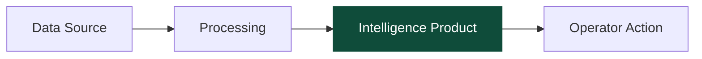

# Quatro Mermaid Theme

For any Mermaid diagram on a Quatro page, open the diagram block with this theme init. This gives every Mermaid figure in a Quatro post the same typographic and color discipline as the rest of the site.

## The Theme Block

```
%%{init: {
  'theme':'base',
  'themeVariables': {
    'primaryColor':'#F9FAFB',
    'primaryTextColor':'#0a0a0a',
    'primaryBorderColor':'#0a0a0a',
    'lineColor':'#475569',
    'secondaryColor':'#E2E8F0',
    'tertiaryColor':'#FFFFFF',
    'fontFamily':'Roobert, system-ui, sans-serif',
    'fontSize':'13px'
  }
}}%%
```

Paste this as the first line of every Mermaid block on a Quatro surface.

## Applying Forest-Green Emphasis

Forest green is not a theme variable. It is applied as a manual class on the one emphasized node, per Quatro's single-emphasis rule.

Example:



Only one node ever gets the `emphasis` class per diagram.

## Ochre on Eco-Track

For eco-track diagrams only, ochre can be used as a second fill for a secondary element. Never appears alongside forest on the same element.

```
classDef eco fill:#A88B5C,stroke:#A88B5C,color:#0a0a0a;
```

## Font Scaling Across Devices

The theme specifies `fontSize: 13px` for reliable readability. For hero-scale diagrams that need bigger labels, override per-node rather than globally to keep the rest of the series consistent.

## What This Theme Does Not Change

The base `technical-diagrams` skill's C4 grammar, DAG rules, BPMN-lite, ERD patterns, and marktecture disciplines stay intact. The theme only changes how Mermaid renders color, border, and font on Quatro surfaces. Everything else inherits from the base skill.
